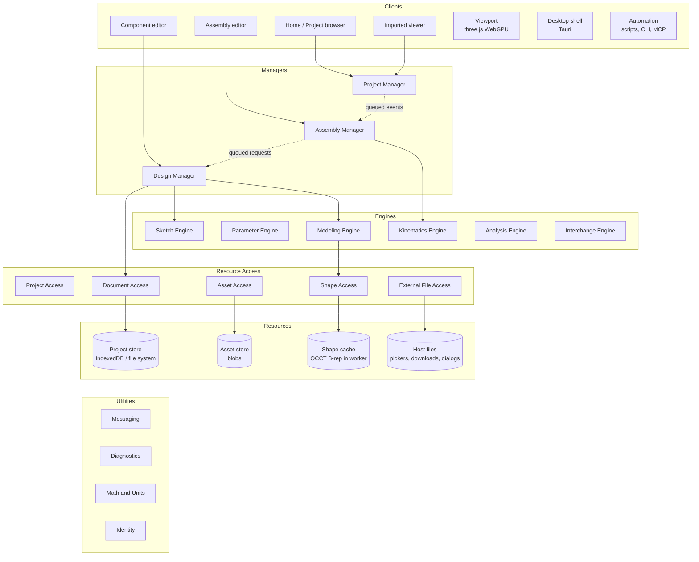
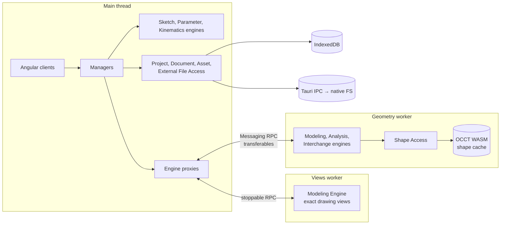

# Architecture

CADence follows **iDesign** (Juval Löwy, *Righting Software*). The system is decomposed by **volatility**, not by function: each component encapsulates one area that is likely to change, so a change stays inside one component. The functional requirements (projects, sketches, features, assemblies, import/export) are not components. They come out of how these components *interact*, as shown in [[Architecture/Use cases and call chains]].

[TOC]

## Layers



The diagram shows a representative selection of calls. The complete matrix follows in [[Architecture#Who uses what]].

The Viewport is a presentation component shared by the editors. It only renders the mesh DTOs the managers return, and it never calls a manager itself. The Desktop shell hosts the same web app and provides the native resources (file system, dialogs) that the Resource Access implementations for desktop use.

### Who uses what

Clients enter through one manager each: Home and the Imported viewer use the **Project Manager**, the Component editor uses the **Design Manager**, and the Assembly editor uses the **Assembly Manager**.

| | Sketch | Parameter | Modeling | Kinematics | Analysis | Interchange | Project Access | Document Access | Asset Access | Shape Access | External File Access |
| --- | :-: | :-: | :-: | :-: | :-: | :-: | :-: | :-: | :-: | :-: | :-: |
| **Project Manager** | | | ● | | | ● | ● | ● | ● | | ● |
| **Design Manager** | ● | ● | ● | | ● | ● | | ● | ● | | ● |
| **Assembly Manager** | | ● | ● | ● | ● | ● | | ● | ● | | ● |
| **Modeling Engine** | | | | | | | | | | ● | |
| **Analysis Engine** | | | | | | | | | | ● | |
| **Interchange Engine** | | | | | | | | | | ● | |

Project Access, Document Access and Asset Access read and write the project store and asset store. Shape Access works on the in-worker shape cache, and External File Access on the host's file pickers, downloads and dialogs.

## Call rules

These rules are enforced by the **architecture test** ([[tools/architecture/rules.ts]]). It runs with `npm test` over the real import graph and fails on any violation (see [[Conventions]]):

| From → To | Allowed? |
| --- | --- |
| Client → Manager | ✅ the only way into the system |
| Client → Engine / Resource Access | ❌ |
| Manager → Engine, Resource Access | ✅ |
| Manager → Manager | ⚠️ only queued (fire-and-forget domain events), never synchronous calls |
| Engine → Resource Access | ✅ |
| Engine → Engine | ❌ the manager orchestrates; engines share data through Resource Access (Shape Access) |
| Resource Access → Resource | ✅ |
| Anything → Utilities, Contracts | ✅ |
| Any upward call | ❌ (results flow back as return values or event streams) |
| Platform adapter (`src/app/platform`) → Resource Access, Utilities, Contracts | ✅ host-specific implementations of access and utility ports that cannot live in the core because they need Tauri |
| Client → Platform adapter | ✅ only to choose the host in `app.config.ts` |
| Main thread (clients, managers, composition) → kernel-bound engines (Modeling, Interchange, Analysis), Shape Access, replicad | types only; their code loads in the geometry worker ([[Architecture/Decisions#ADR-22]]) |

Each component exposes an **interface plus a factory** from its `index.ts`. The implementation stays private, and the architecture test rejects imports of another component's internals. A component's `testing/` folder (contract suites, test doubles) is a second entry point that only tests may use, and its `node.ts` (adapters over `node:fs` and the like) is a third that only Node code may use: tests, the automation client and other `node.ts` files, so browser bundles never see Node modules. Wiring happens in exactly one **composition root per host** (browser, desktop or Node), and Angular DI provides the managers to the Angular clients through injection tokens.

## Deployment and threads

Where code runs is volatile too: the main thread, a Web Worker, or native Rust inside Tauri. Engines are therefore called through **async interfaces**, so an engine can move between threads without changing its managers. The Messaging utility provides typed worker RPC, and transferable typed arrays carry the meshes.



- **Managers and storage Resource Access stay on the main thread.** Tauri IPC is not available inside Web Workers, and IndexedDB works on both. Keeping them here keeps one code path for both hosts.
- **Kernel-bound engines share one geometry worker.** OCCT shapes cannot cross thread boundaries cheaply, so Modeling, Analysis (geometric checks) and Interchange share the in-worker shape cache through Shape Access. Engines exchange shapes by key rather than by calling each other.
- **Drawing views are drawn exactly in a views worker of their own**, a second kernel that is stopped when a view takes longer than 20 s (`stoppable` in Messaging), since WebAssembly cannot be interrupted; the Drawing Manager then draws that view from the triangles in the geometry worker ([[Architecture/Decisions#ADR-49]]). Scripts and the MCP server start it as a Node worker of the same module.
- **A kernel that fails is replaced.** When the geometry kernel runs out of memory or traps, the next call loads a new one (in the browser, in the same worker; for the MCP server, a new Node geometry worker, `restartable` in Messaging), and the documents open on it are read again. The MCP server runs the kernel in a worker too, so it answers other requests while a long check runs, and a cancelled call stops the worker ([[Architecture/Decisions#ADR-52]]).
- **The desktop app watches its project folders.** Changes other processes make (an agent's MCP server, a script) become the events other windows send, through the composition root (`Host.watch`, [[Architecture/Decisions#ADR-53]]).
- **The viewport owns how the model is seen** (camera, projection, section); documents own how bodies look; the user's preferences (control scheme) are kept per install ([[Architecture/Decisions#ADR-24]]).
- **The web app's files and kernels are cached by a service worker** (web only), so it runs offline; the desktop app bundles them ([[Architecture/Decisions#ADR-23]]).
- **Light engines run on the main thread.** Parameter and Kinematics are pure and synchronous (a solve takes well under a millisecond for home-sized assemblies); Sketch (planegcs, about 1 MB of WASM) is async. Any of them can move to a worker behind an async proxy once profiling shows a need.

## Technology

| Concern | Choice | See |
| --- | --- | --- |
| Client framework | Angular 22: standalone, zoneless, signals, `OnPush`, deferrable views | [[Architecture/Decisions#ADR-7]] |
| B-rep kernel | OpenCascade (OCCT) via `replicad-opencascadejs` WASM in a Web Worker | [[Architecture/Decisions#ADR-2]] |
| Sketch constraints | `@salusoft89/planegcs` (FreeCAD GCS as WASM) | [[Architecture/Decisions#ADR-3]] |
| Rendering | three.js `WebGPURenderer` with automatic WebGL2 fallback | [[Architecture/Decisions#ADR-6]] |
| Storage | IndexedDB (browser), project folder on disk (desktop) | [[Architecture/Decisions#ADR-5]] |
| Desktop | Tauri 2 | [[Architecture/Decisions#ADR-4]] |
| Speed-ups | WASM kernels; Rust/WASM where profiling proves a hotspot | [[Architecture/Decisions#ADR-8]] |
| Tests | Vitest (unit, TDD), Playwright (end to end and visual evidence) | [[Architecture/Decisions#ADR-9]] |

## Code layout

```
src/
  app/                    Clients (Angular): home, editor (shell + modes), viewport, shared UI
    platform/             Host adapters for the client, e.g. the Tauri file system
  core/
    contracts/            Data contracts: document model, DTOs, commands, events
    managers/             project/  design/  assembly/
    engines/              sketch/  parameter/  modeling/  kinematics/  analysis/  interchange/
    access/               project/  document/  asset/  shape/  external-file/
    utilities/            messaging/  diagnostics/  math/  identity/
    composition/          composition roots: createBrowserCore, createDesktopCore, createInMemoryCore; node.ts: createNodeCore
  workers/                geometry.worker.ts (hosts the kernel-bound engines)
  automation/             Client in Node: scripting API, command line, MCP server (built by tools/automation/build.mjs)
src-tauri/                Desktop shell (Rust)
e2e/                      Playwright specs and evidence screenshots
tools/architecture/       The architecture test (call rules over the import graph)
tools/benchmark/          Benchmarks of large models (npm run bench, [[Architecture/Performance]])
```

`src/core` has no dependency on Angular. It runs under Node in unit tests, and both OCCT and planegcs load in Node, so engines are tested headless.

[SUBPAGES]
