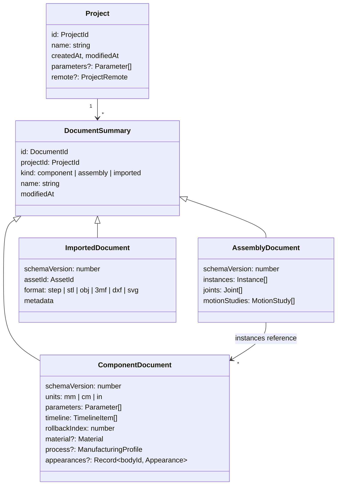

# Document model

These are the persisted data contracts (`src/core/contracts`). A document stores only the **design intent**: parameters, sketches and features as typed data with expressions. Geometry is derived by regeneration. The only stored geometry is caches: thumbnails and published component results.

[TOC]

## Projects and documents



All lengths are stored **in millimetres**, and `units` controls display only. Angles are stored in degrees in expressions and in radians internally. Plain numbers in expressions are millimetres; a plain number typed in a document of another unit is saved with the unit written out (`lengthExpression`), so changing `units` never changes the model.

## Versions

Each project has a version history: a git repository with one commit per version on `main` and version names as tags ([[Architecture/Decisions#ADR-30]]). A version holds the files

| Path | Content |
| --- | --- |
| `documents/<documentId>.json` | the document as stored, without `projectId` (a project has its own id on each device) |
| `originals/<assetId>` | an imported document's original file, unchanged |
| `project.json` | `{ name, parameters }` |

`Project.remote` (`{ url, corsProxy? }`) is where the versions are synced; it is a setting of this device and not part of the versions. Sign-ins are never stored.

## Archives and templates

A project archive (`.cadence`) is a zip with `cadence.json` (`{ format: 'cadence-project', version: 1, name, parameters }`), `documents/<id>.json` (without `projectId`), `originals/<assetId>` and, optionally, `history/…`, the files of the project's git repository. Opening one keeps the documents' ids and history unless this device has those documents already; then they get new ids and the history starts anew.

A template (`ProjectTemplate`, `public/templates/<id>.json`) is `{ id, name, description, parameters, documents }`: a project without originals. Templates are made with the scripting API ([[src/automation/templates.ts]]); a test builds them, compares them with the files and checks their volumes.

## Component results

The one exception to "geometry is never stored" is the **published result** of a component: the B-rep of each body (OCCT text) with its face and edge names in topological order, written by the Design Manager after every change and stamped with the component's `modifiedAt`. It is a cache, so deleting it is always safe; assemblies request a regeneration when it is missing or its stamp is not the component's `modifiedAt` ([[Architecture/Decisions#ADR-11]]). The stamp also covers the project parameters (`resultStamp`: `modifiedAt#<hash>`), and every configuration has a result of its own, kept under `<component>@<configuration>` (`resultKey`).

## Material and manufacturing profile

A component optionally stores what it is made of and on which machine ([[src/core/contracts/analysis.ts]], [[Architecture/Decisions#ADR-19]]):

```ts
interface Material { name: string; density: number }   // g/cm³; PLA (1.24) when absent
type ManufacturingProfile =
  | { kind: 'print'; name; bed: [x, y, z]; nozzle; layerHeight; maxOverhang }   // mm, overhang in degrees from vertical
  | { kind: 'laser'; name; bed: [x, y]; kerf; thickness };                    // mm
```

When absent, the first preset applies (an FDM printer with a 220 × 220 × 250 mm volume and a 0.4 mm nozzle). The fields are optional, so older documents need no migration.

## Parameters

```ts
interface Parameter { id: ParameterId; name: string; expression: string; comment?: string }
```

Expressions may reference other parameters by name, use units (`10 mm + 0.5 in`) and functions (`sin`, `max`, ...). Feature and constraint values are expressions too, so `"height / 2"` works everywhere a number does.

- **Project parameters** (`Project.parameters`) are in scope in every component of the project; a component parameter of the same name wins. Changing them publishes `projectParametersChanged`.
- **Configurations** (`ComponentDocument.configurations`): `{ id, name, values: Record<parameter name, expression> }`. `configuration` is the one shown and edited; regeneration replaces the named parameters' expressions with its values. An assembly `Instance.configuration` shows another one (`sourceKey`: `<component>@<configuration>`).

## Timeline items

```ts
type TimelineItem = Sketch | Feature;   // today: Sketch only
```

### Sketches

As implemented in [[src/core/contracts/sketch.ts]]:

```ts
interface Sketch {
  id: string; type: 'sketch'; name: string; suppressed: boolean;
  plane: 'XY' | 'XZ' | 'YZ';         // origin planes now; construction planes and faces in phase 3
  entities: SketchEntity[];           // points, lines, circles, arcs, ellipses, splines (each curve has a construction flag), projections, texts, drawings, equations, pictures
  constraints: SketchConstraint[];    // geometric relations and dimensions
}
```

- **Points are entities of their own.** Curves reference them by id, so a shared corner *is* one point: drawing a polyline or a rectangle needs no coincident constraints, and dragging a corner moves every curve on it. Every sketch also has the implicit, fixed point `origin` at (0, 0).
- **Arcs** run counter-clockwise from `start` to `end` around `center`. Their radius follows from the points; circles store a `radius`.
- **Plane coordinates** (u, v) map to the world as: XY → (x, y), XZ → (x, z), YZ → (y, z), each seen head-on from the top, front and right view respectively.
- **Geometric constraints:** coincident, horizontal, vertical, parallel, perpendicular, equal (lengths or radii), tangent, point-on (line, circle or arc), midpoint, fix.
- **Dimensions** store an **expression**, not a number: distance, horizontal and vertical distance, point-to-line distance, radius, diameter, angle. `"2 * 20 mm"` and `"1 in"` are valid values. Signs and orientation (which side, which of the supplementary angles) follow the current geometry, so a dimension never flips the sketch over.
- **Points store their last solved positions.** The solver needs a starting guess, and the document opens exactly as last seen, even before solving.
- **Generated geometry.** Projections, drawings kept as one piece and equation curves (`{ kind: 'equation', x, y, from, to, samples }`) generate their points and curves (`<id>:<n>`) on every regeneration; generated points are fixed for the solver. A drawing of a picture carries `trace: { threshold, smooth }`.
- **Pictures** (`{ kind: 'picture', document, origin, handle, opacity, hidden }`) are shown behind the sketch, placed by two ordinary points; they are not geometry.
- **Texts** may name an imported font (`font`, a document id) and follow a curve (`along: { curve, offset, reversed }`).

### Features

Each feature type is its own interface in [[src/core/contracts/feature.ts]]. All numbers are expressions.

| Type | Inputs | Values |
| --- | --- | --- |
| `insert` | an imported STEP, STL, OBJ or 3MF document | (its solids become new bodies) |
| `extrude` | sketch, profile ids | distance; direction (normal, reverse, symmetric); operation |
| `revolve` | sketch, profile ids, axis (origin axis, sketch construction line or edge) | angle; operation |
| `fillet`, `chamfer` | edges (`TopologyRef`) | radius / distance |
| `shell` | faces to open | wall thickness (inward) |
| `plane` | base plane (origin plane, construction plane or flat face) | offset |
| `linear-pattern`, `circular-pattern` | extrudes/revolves to repeat, direction / axis | count, spacing / angle (360° spreads evenly) |
| `mirror` | extrudes/revolves to mirror, plane | |
| `loft` | sections: a profile of each of two or more sketches, in order | ruled (straight) or smooth; operation |
| `sweep` | sketch, profile ids, path (a sketch whose curves form one chain) | operation |
| `path-pattern` | features to repeat, path (a sketch) | count; align (turn with the path) |
| `hole` | sketch and its points (centres) | kind (simple, counterbore, countersink); diameter; through or a depth; counterbore diameter and depth; countersink diameter and angle; teardrop; bridge |
| `thread` | a round face | ISO metric size (`metricThreads`); length (empty: the whole face); modelled; flip |
| `draft` | faces, neutral plane | angle |
| `rib` | sketch (open curves) | thickness; depth; direction |
| `combine` | target body, tool bodies | join, cut or intersect; keep tools |
| `split` | body, plane | |
| `move` | bodies, axis | translation (x, y, z); angle; copy |
| `scale` | bodies | factor (about the origin) |
| `base-flange` | sketch, profile ids | direction; the sheet's rules: thickness, bend radius, K-factor |
| `edge-flange` | straight edges of the sheet | length; angle |

Construction `plane`s have a `mode`: `offset` (the default, from a base plane), `angle` (about an axis in the base plane), `midplane` (between the base and a parallel second plane) or `points` (three vertices).

The **rollback marker** is `rollbackIndex`: how many items at the end of the timeline are rolled back (0: none). Regeneration stops before them and marks them `rolled-back`; new items are inserted before them. Reordering is refused when an item would come before an item it uses: its sketch, plane, repeated features, path, or a feature named in the bodies, faces and edges it refers to (`itemDependencies` in [[src/core/managers/design/commands.ts]]).

The **operation** of extrude and revolve is `new-body`, `join` (into the bodies the tool touches; a new body when it touches none), `cut` or `intersect` (every touched body). Bodies are identified by the feature that created them.

**Patterns and mirrors repeat a feature's tool**, the solid an extrude or revolve made, with that feature's operation. So a pattern of a cut repeats the hole, and a pattern of a boss repeats the boss.

Sketches lie on a `PlaneRef`: `'XY' | 'XZ' | 'YZ'`, `{ face: TopologyRef }` (a flat face, which moves with it) or `{ plane: featureId }` (a construction plane). Planes on faces orient like the origin planes: on horizontal faces u follows world X, on other faces v points up.

## Persistent references

> [!IMPORTANT]
> The "topological naming problem" decides whether parametric edits survive. References must never store kernel indices such as "face #7".

A `TopologyRef` stores a **generated name**, never an index ([[src/core/contracts/feature.ts]]):

```ts
interface TopologyRef {
  kind: 'face' | 'edge';
  body: string;      // the body: the id of the feature that created it
  name: string;      // e.g. "f:extrude1:side:line7" or "e:f:extrude1:end|f:extrude1:side:line7"
  hint?: Vec3;       // where it was when picked; tells split pieces apart
}
```

The Modeling Engine names every face after each feature (*generative naming*, [[src/core/engines/modeling/naming.ts]]):

| Face | Name |
| --- | --- |
| Extrude cap | `f:<feature>:start` / `f:<feature>:end` |
| Extrude or revolve side | `f:<feature>:side:<sketch curve id>`, recognised because the curve sweeps exactly that surface (a plane for a line, a cylinder, cone, sphere or torus for others) |
| Fillet or chamfer face | `f:<feature>:round:<edge name>` / `f:<feature>:bevel:<edge name>` |
| Shell inner face | `f:<feature>:inner` |
| Pattern or mirror copy | the original's name plus `@<feature>.<n>` |
| Loft or sweep side | `f:<feature>:side:<sketch curve id>`, from the kernel's history: the faces generated from that profile edge (along the whole path) |
| Loft or sweep cap | `f:<feature>:start` / `f:<feature>:end` |
| Hole face | `f:<feature>:wall:<point>`, `bore`, `sink`, `floor` or `tip` (teardrop flats), by the sketch point of the hole |
| Split face | `f:<feature>:split` |
| Drafted face | its old name: it is the same face, tilted (from the kernel's history) |
| Thread groove | `f:<feature>:flank` |
| Rib | `f:<feature>:side`, `start`, `end` |
| Edge flange | `f:<feature>:bend:<edge>` (round), `f:<feature>:flange:<edge>` (flat) |
| Anything else new | `f:<feature>:new:<n>`, in order of position |

- **Inherited names.** A face that lies on the same exact surface as a face of the feature's inputs keeps that face's name, however it was trimmed. Planes also match with the other side facing (a hole's wall faces the other way to the tool face that cut it). Freeform faces (B-splines, and cones and tori, whose parameters the kernel build cannot read) match when probe points of the earlier face's surface lie on the new face's surface. This is why changing an upstream dimension keeps downstream references valid: the names follow the design intent, not the kernel's numbering.
- **Edges** are named after the faces they separate: `e:<face A>|<face B>`.
- **Vertices** are named after the edges that meet there: `v:<edge>&<edge>&…`, sorted. A vertex reference that no longer matches resolves only where it was picked.
- **Repeated names.** When a name occurs more than once (a face split in two), `~1`, `~2` … are appended in order of position.
- **Resolution.** A reference resolves by exact name, then among the split pieces of that name (nearest to the hint). A reference that cannot be resolved makes its feature fail with "… no longer exists. Pick it again". It is never silently re-bound to a different face.

## Assemblies

As implemented in [[src/core/contracts/assembly.ts]]:

```ts
interface AssemblyDocument { instances: Instance[]; joints: Joint[]; motionStudies: MotionStudy[] }
interface Instance { id: string; component: DocumentId; name: string; transform: Matrix4; grounded: boolean; appearance?: Appearance }
interface Appearance { hidden?: boolean; color?: string /* #rrggbb */; opacity?: number /* 0.1 to 1 */ }  // display only, never geometry
interface Joint {
  id: string; name: string;
  type: 'rigid' | 'revolute' | 'slider' | 'cylindrical' | 'pin-slot' | 'planar' | 'ball';
  a: JointOrigin; b: JointOrigin;          // { instance, ref?: TopologyRef }; no ref = component origin
  flip: boolean;                            // B's frame turned over
  values: number[];                         // one per degree of freedom: mm or degrees
  limits: ({ min: number; max: number } | null)[];
}
interface MotionStudy { id: string; name: string; duration: number; keys: { time: number; joint: string; values: number[] }[] }
```

- `Matrix4` is a rigid 4 × 4 transform, column-major like three.js (translation at 12, 13, 14).
- An instance's `transform` is where it sits when no joint places it; joints place the others ([[Architecture/Decisions#ADR-20]]).
- The degrees of freedom of each joint type, and the order of `values`, are `jointDofs`: a revolute joint turns about z; a slider moves along z; cylindrical does both; pin-slot slides along x and turns about z; planar moves in x and y and turns about z; a ball turns about z, y and x.
- Joint frames come from the referenced geometry ([[Architecture/Decisions#ADR-21]]).

## Schema versioning

Every document carries `schemaVersion`. Document Access runs pure migration functions (`vN → vN+1`, [[src/core/access/document/migrations.ts]]) on read and always writes the newest version. Each migration has a unit test.

| Version | Change |
| --- | --- |
| 1 | First schema |
| 2 | Assemblies get `motionStudies` (empty for older assemblies) |
