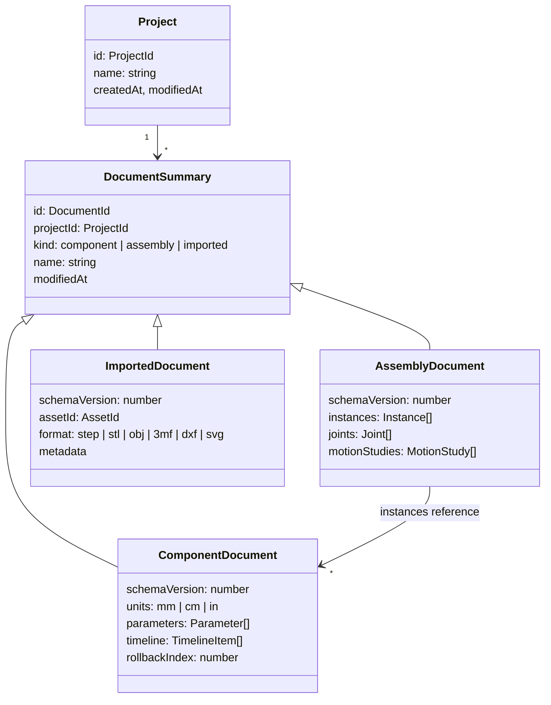

# Document model

These are the persisted data contracts (`src/core/contracts`). A document stores only the **design intent**: parameters, sketches and features as typed data with expressions. Geometry is derived by regeneration. The only stored geometry is caches: thumbnails and published component results.

[TOC]

## Projects and documents



All lengths are stored **in millimetres**, and `units` controls display only. Angles are stored in degrees in expressions and in radians internally.

## Component results

The one exception to "geometry is never stored" is the **published result** of a component: its B-rep (OCCT `.brep`), mesh and topology names, written by the Design Manager after each successful full regeneration and keyed by the document's content hash. It is a cache, so deleting it is always safe; assemblies request a regeneration when it is missing or stale.

## Parameters

```ts
interface Parameter { id: ParameterId; name: string; expression: string; comment?: string }
```

Expressions may reference other parameters by name, use units (`10 mm + 0.5 in`) and functions (`sin`, `max`, ...). Feature and constraint values are expressions too, so `"height / 2"` works everywhere a number does.

## Timeline items

```ts
type TimelineItem = Sketch | Feature;   // today: Sketch only
```

### Sketches

As implemented in [[src/core/contracts/sketch.ts]]:

```ts
interface Sketch {
  id: string; type: 'sketch'; name: string; suppressed: boolean;
  plane: 'XY' | 'XZ' | 'YZ';         // origin planes now; construction planes and faces in phase 3
  entities: SketchEntity[];           // points, lines, circles, arcs (each curve has a construction flag)
  constraints: SketchConstraint[];    // geometric relations and dimensions
}
```

- **Points are entities of their own.** Curves reference them by id, so a shared corner *is* one point: drawing a polyline or a rectangle needs no coincident constraints, and dragging a corner moves every curve on it. Every sketch also has the implicit, fixed point `origin` at (0, 0).
- **Arcs** run counter-clockwise from `start` to `end` around `center`. Their radius follows from the points; circles store a `radius`.
- **Plane coordinates** (u, v) map to the world as: XY → (x, y), XZ → (x, z), YZ → (y, z), each seen head-on from the top, front and right view respectively.
- **Geometric constraints:** coincident, horizontal, vertical, parallel, perpendicular, equal (lengths or radii), tangent, point-on (line, circle or arc), midpoint, fix.
- **Dimensions** store an **expression**, not a number: distance, horizontal and vertical distance, point-to-line distance, radius, diameter, angle. `"2 * 20 mm"` and `"1 in"` are valid values. Signs and orientation (which side, which of the supplementary angles) follow the current geometry, so a dimension never flips the sketch over.
- **Points store their last solved positions.** The solver needs a starting guess, and the document opens exactly as last seen, even before solving.

```ts
interface Feature {
  id: FeatureId; type: FeatureType; name: string; suppressed: boolean;
  inputs: Record<string, TopologyRef | TopologyRef[] | ProfileRef[]>;
  params: Record<string, Expression | string | boolean>;
  operation?: 'new-body' | 'join' | 'cut' | 'intersect';
}
```

Feature types start with `extrude`, `revolve`, `fillet`, `chamfer`, `shell`, `linear-pattern`, `circular-pattern`, `mirror`, `construction-plane`, and grow to `sweep`, `loft`, `draft` and more. Every feature type is one module in the Modeling Engine's feature registry plus one dialog in the client, so adding a feature never touches the manager.

## Persistent references

> [!IMPORTANT]
> The "topological naming problem" decides whether parametric edits survive. References must never store kernel indices such as "face #7".

A `TopologyRef` is a **semantic descriptor** built from how the topology was created:

```ts
interface TopologyRef {
  feature: FeatureId;                 // the feature that generated the element
  role: string;                       // e.g. 'side', 'start-cap', 'end-cap', 'fillet-face'
  source?: SketchEntityId | TopologyRef;  // generating sketch segment or parent element
  kind: 'face' | 'edge' | 'vertex';
  hint?: GeometricFingerprint;        // centroid/normal/area for disambiguation and repair
}
```

The Modeling Engine names topology after each feature, using OCCT's construction history (`Generated` / `Modified` of the make-shape algorithms). It resolves references by matching the descriptor first and the fingerprint as a fallback. A reference that cannot be resolved surfaces as a feature error the user can repair. It is never silently re-bound to a different face.

## Assemblies

```ts
interface Instance { id: InstanceId; componentId: DocumentId; name: string; transform: Matrix4; grounded: boolean }
interface Joint {
  id: JointId; type: 'rigid' | 'revolute' | 'slider' | 'cylindrical' | 'pin-slot' | 'planar' | 'ball';
  a: JointOrigin; b: JointOrigin;     // instance + TopologyRef-based frame
  limits?: { min: Expression; max: Expression }; value?: Expression;
}
interface MotionStudy { id: MotionStudyId; name: string; duration: number; keys: { joint: JointId; t: number; value: Expression }[] }
```

## Schema versioning

Every document carries `schemaVersion`. Document Access runs pure migration functions (`vN → vN+1`) on read and always writes the newest version. Each migration has a fixture-based unit test.
