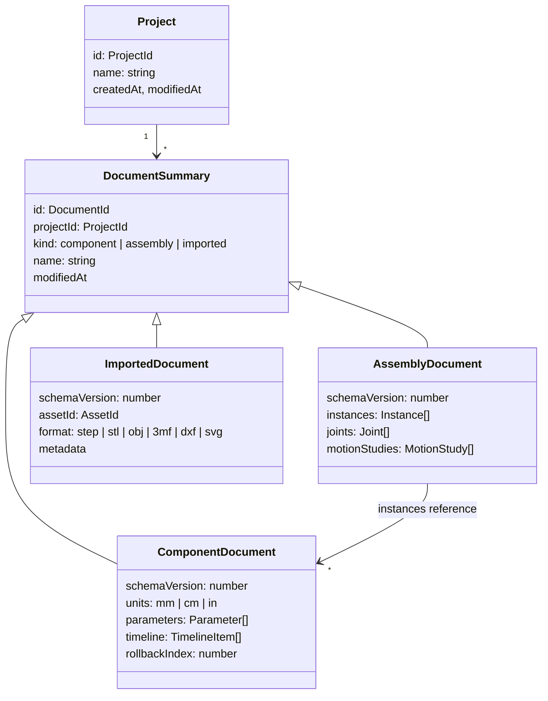

# Document model

These are the persisted data contracts (`src/core/contracts`). A document stores only the **design intent**: parameters, sketches and features as typed data with expressions. Geometry is derived by regeneration. The only stored geometry is caches: thumbnails and published component results.

[TOC]

## Projects and documents



All lengths are stored **in millimetres**, and `units` controls display only. Angles are stored in degrees in expressions and in radians internally.

## Component results

The one exception to "geometry is never stored" is the **published result** of a component: its B-rep (OCCT `.brep`), mesh and topology names, written by the Design Manager after each successful full regeneration and keyed by the document's content hash. It is a cache, so deleting it is always safe; assemblies request a regeneration when it is missing or stale.

## Parameters

```ts
interface Parameter { id: ParameterId; name: string; expression: string; comment?: string }
```

Expressions may reference other parameters by name, use units (`10 mm + 0.5 in`) and functions (`sin`, `max`, ...). Feature and constraint values are expressions too, so `"height / 2"` works everywhere a number does.

## Timeline items

```ts
type TimelineItem = Sketch | Feature;   // today: Sketch only
```

### Sketches

As implemented in [[src/core/contracts/sketch.ts]]:

```ts
interface Sketch {
  id: string; type: 'sketch'; name: string; suppressed: boolean;
  plane: 'XY' | 'XZ' | 'YZ';         // origin planes now; construction planes and faces in phase 3
  entities: SketchEntity[];           // points, lines, circles, arcs (each curve has a construction flag)
  constraints: SketchConstraint[];    // geometric relations and dimensions
}
```

- **Points are entities of their own.** Curves reference them by id, so a shared corner *is* one point: drawing a polyline or a rectangle needs no coincident constraints, and dragging a corner moves every curve on it. Every sketch also has the implicit, fixed point `origin` at (0, 0).
- **Arcs** run counter-clockwise from `start` to `end` around `center`. Their radius follows from the points; circles store a `radius`.
- **Plane coordinates** (u, v) map to the world as: XY → (x, y), XZ → (x, z), YZ → (y, z), each seen head-on from the top, front and right view respectively.
- **Geometric constraints:** coincident, horizontal, vertical, parallel, perpendicular, equal (lengths or radii), tangent, point-on (line, circle or arc), midpoint, fix.
- **Dimensions** store an **expression**, not a number: distance, horizontal and vertical distance, point-to-line distance, radius, diameter, angle. `"2 * 20 mm"` and `"1 in"` are valid values. Signs and orientation (which side, which of the supplementary angles) follow the current geometry, so a dimension never flips the sketch over.
- **Points store their last solved positions.** The solver needs a starting guess, and the document opens exactly as last seen, even before solving.

### Features

Each feature type is its own interface in [[src/core/contracts/feature.ts]]. All numbers are expressions.

| Type | Inputs | Values |
| --- | --- | --- |
| `extrude` | sketch, profile ids | distance; direction (normal, reverse, symmetric); operation |
| `revolve` | sketch, profile ids, axis (origin axis, sketch construction line or edge) | angle; operation |
| `fillet`, `chamfer` | edges (`TopologyRef`) | radius / distance |
| `shell` | faces to open | wall thickness (inward) |
| `plane` | base plane (origin plane, construction plane or flat face) | offset |
| `linear-pattern`, `circular-pattern` | extrudes/revolves to repeat, direction / axis | count, spacing / angle (360° spreads evenly) |
| `mirror` | extrudes/revolves to mirror, plane | |

The **operation** of extrude and revolve is `new-body`, `join` (into the bodies the tool touches; a new body when it touches none), `cut` or `intersect` (every touched body). Bodies are identified by the feature that created them.

**Patterns and mirrors repeat a feature's tool**, the solid an extrude or revolve made, with that feature's operation. So a pattern of a cut repeats the hole, and a pattern of a boss repeats the boss.

Sketches lie on a `PlaneRef`: `'XY' | 'XZ' | 'YZ'`, `{ face: TopologyRef }` (a flat face, which moves with it) or `{ plane: featureId }` (a construction plane). Planes on faces orient like the origin planes: on horizontal faces u follows world X, on other faces v points up.

## Persistent references

> [!IMPORTANT]
> The "topological naming problem" decides whether parametric edits survive. References must never store kernel indices such as "face #7".

A `TopologyRef` stores a **generated name**, never an index ([[src/core/contracts/feature.ts]]):

```ts
interface TopologyRef {
  kind: 'face' | 'edge';
  body: string;      // the body: the id of the feature that created it
  name: string;      // e.g. "f:extrude1:side:line7" or "e:f:extrude1:end|f:extrude1:side:line7"
  hint?: Vec3;       // where it was when picked; tells split pieces apart
}
```

The Modeling Engine names every face after each feature (*generative naming*, [[src/core/engines/modeling/naming.ts]]):

| Face | Name |
| --- | --- |
| Extrude cap | `f:<feature>:start` / `f:<feature>:end` |
| Extrude or revolve side | `f:<feature>:side:<sketch curve id>`, recognised because the curve sweeps exactly that surface (a plane for a line, a cylinder, cone, sphere or torus for others) |
| Fillet or chamfer face | `f:<feature>:round:<edge name>` / `f:<feature>:bevel:<edge name>` |
| Shell inner face | `f:<feature>:inner` |
| Pattern or mirror copy | the original's name plus `@<feature>.<n>` |
| Anything else new | `f:<feature>:new:<n>`, in order of position |

- **Inherited names.** A face that lies on the same exact surface as a face of the feature's inputs keeps that face's name, however it was trimmed. This is why changing an upstream dimension keeps downstream references valid: the names follow the design intent, not the kernel's numbering.
- **Edges** are named after the faces they separate: `e:<face A>|<face B>`.
- **Repeated names.** When a name occurs more than once (a face split in two), `~1`, `~2` … are appended in order of position.
- **Resolution.** A reference resolves by exact name, then among the split pieces of that name (nearest to the hint). A reference that cannot be resolved makes its feature fail with "… no longer exists. Pick it again". It is never silently re-bound to a different face.

## Assemblies

```ts
interface Instance { id: InstanceId; componentId: DocumentId; name: string; transform: Matrix4; grounded: boolean }
interface Joint {
  id: JointId; type: 'rigid' | 'revolute' | 'slider' | 'cylindrical' | 'pin-slot' | 'planar' | 'ball';
  a: JointOrigin; b: JointOrigin;     // instance + TopologyRef-based frame
  limits?: { min: Expression; max: Expression }; value?: Expression;
}
interface MotionStudy { id: MotionStudyId; name: string; duration: number; keys: { joint: JointId; t: number; value: Expression }[] }
```

## Schema versioning

Every document carries `schemaVersion`. Document Access runs pure migration functions (`vN → vN+1`) on read and always writes the newest version. Each migration has a fixture-based unit test.
