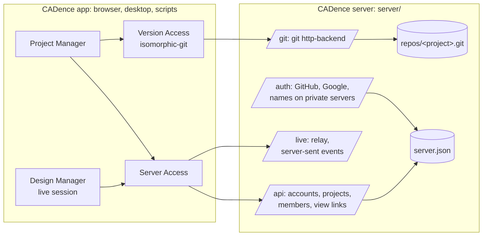

# Server

The CADence server lets people sign in, share projects and edit them together, live ([[CAD-177]], [[CAD-178]], [[Architecture/Decisions#ADR-61a]]). It is optional: without one, CADence works as before, and projects still sync with any git host ([[Architecture/Decisions#ADR-30]]).

[TOC]

## What it does



- **Accounts.** People sign in with GitHub or Google (OAuth 2), or, on a server on a private network, with a name alone. The server sends them back to the app with a token in the address's fragment; the app keeps it on the device (like any web app's sign-in) and sends it as a bearer token.
- **Projects.** A shared project is a bare git repository on the server. The app syncs with it as with any git host; the sign-in is the token (or a view link) as password. Members are owners (share it), editors (change it) or viewers (look at it).
- **View links.** An owner makes links that open the project in any browser to view, without an account (`<app>/shared?server=…&link=…`).
- **Live editing.** Everyone with a component open goes live through the relay: changes go to the others at once, in one order for all, with who is where. See [[Architecture/Decisions#ADR-61a]] for how changes are ordered and how a device that was offline catches up.

## Run it

It needs Node 22 or newer and git.

```bash
npm run build:server
```

```bash
CADENCE_DEV_SIGN_IN=1 npm run server
```

Or as a container (from the repository):

```bash
docker build -f server/Dockerfile -t cadence-server .
```

```bash
docker run -p 8787:8787 -v cadence-data:/data -e CADENCE_PUBLIC_URL=https://cadence.example.org -e CADENCE_GITHUB_CLIENT_ID=… -e CADENCE_GITHUB_CLIENT_SECRET=… cadence-server
```

| Variable | Meaning |
| --- | --- |
| `PORT`, `HOST` | Where it listens (8787 on all addresses by default) |
| `CADENCE_DATA` | Its folder: `server.json` and `repos/` (`cadence-data` by default, `/data` in the container). Back this folder up. |
| `CADENCE_PUBLIC_URL` | How browsers reach it, behind a proxy with HTTPS: sign-in return addresses and git addresses use it |
| `CADENCE_GITHUB_CLIENT_ID`, `CADENCE_GITHUB_CLIENT_SECRET` | Sign-in with GitHub: an OAuth app (*Settings → Developer settings → OAuth Apps*) whose callback is `<public URL>/auth/github/callback` |
| `CADENCE_GOOGLE_CLIENT_ID`, `CADENCE_GOOGLE_CLIENT_SECRET` | Sign-in with Google: an OAuth client (Google Cloud console, *Credentials*) with the redirect `<public URL>/auth/google/callback` |
| `CADENCE_DEV_SIGN_IN=1` | Signing in by name alone: only on a private network, and for tests |
| `CADENCE_APP_ORIGINS` | Where the app runs, comma separated (e.g. `https://h3ll5ur7er.github.io,tauri://localhost`): the only places sign-ins return to and browsers may call it from. Every origin by default. |

> [!WARNING]
> Put the server behind HTTPS (a reverse proxy such as Caddy or nginx) before people sign in over the internet: tokens travel in every request. Rooms for live editing live in memory, so the proxy must not buffer `/live/…` responses (server-sent events).

## Its API

| Path | |
| --- | --- |
| `GET /api/info` | Name and ways to sign in |
| `GET /auth/<provider>?return=<app address>` | Signs in; back at the app with `#cadence-server=…&cadence-token=…` |
| `POST /api/sign-in {name}` | Signing in by name (`CADENCE_DEV_SIGN_IN=1` only) |
| `GET /api/me`, `POST /api/sign-out` | Who is signed in; signing out ends the token |
| `GET /api/projects`, `POST /api/projects {name}` | The projects shared with one; a new one (its repository empty until the first sync) |
| `GET /api/projects/<id>` | A project with its git address, members (editors and owners) and links (owners) |
| `POST /api/projects/<id>/members {user, role}`, `DELETE …/members/<user>` | Owners invite someone who signed in once (by name, e-mail or id) or change their role; a project keeps one owner |
| `POST /api/projects/<id>/links`, `DELETE …/links/<token>`, `GET /api/links/<token>` | View links |
| `/git/<id>.git/…` | git over HTTP: members and links fetch, editors and owners push |
| `GET /live/<id>/<document>?client=…&after=…` | The relay's events for a document: a welcome with what was missed and who is there, then entries, presence and departures |
| `POST /live/<id>/<document>`, `…/presence`, `…/snapshot` | A change (`{clientId, payload}`), where one works, a snapshot the room asked for |

> [!NOTE]
> The desktop app opens web links in the system browser, so signing in there with GitHub or Google does not come back to the app yet; signing in by name works, and so do sharing and live editing once signed in.

Its tests ([[server/server.spec.ts]], and live editing through it in [[src/core/managers/design/live.spec.ts]]) run it for real, with git; the browser journeys of phase 42 start one too ([[e2e/versions-and-collaboration.spec.ts]]).
