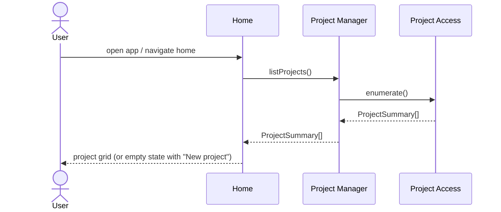
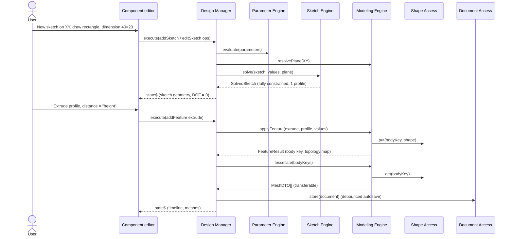
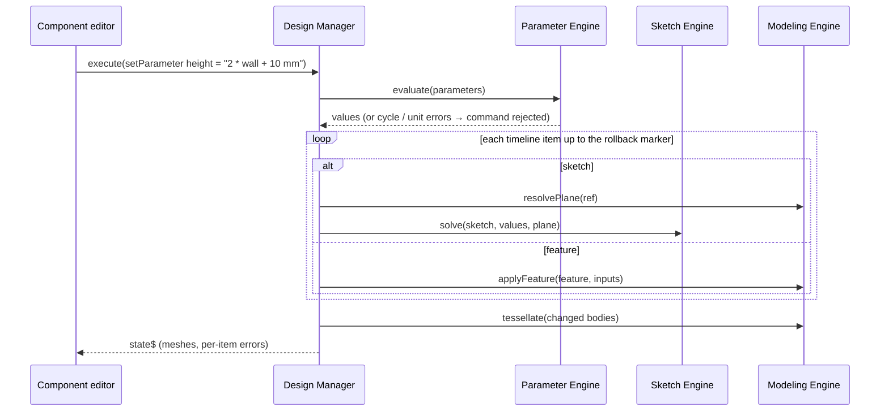
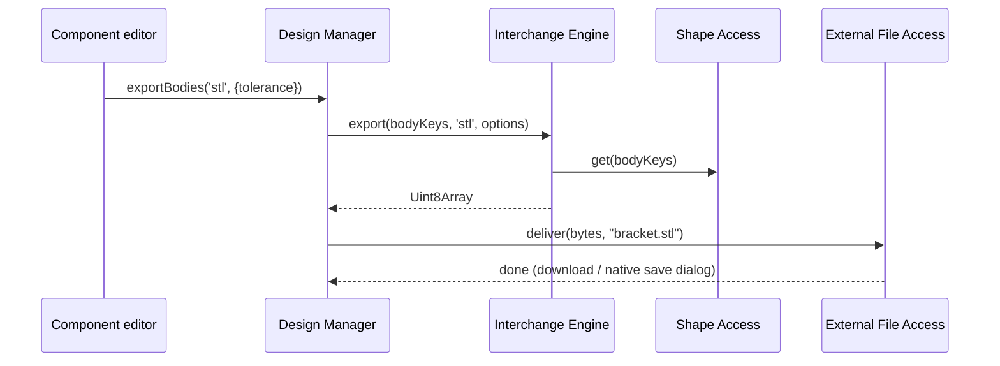
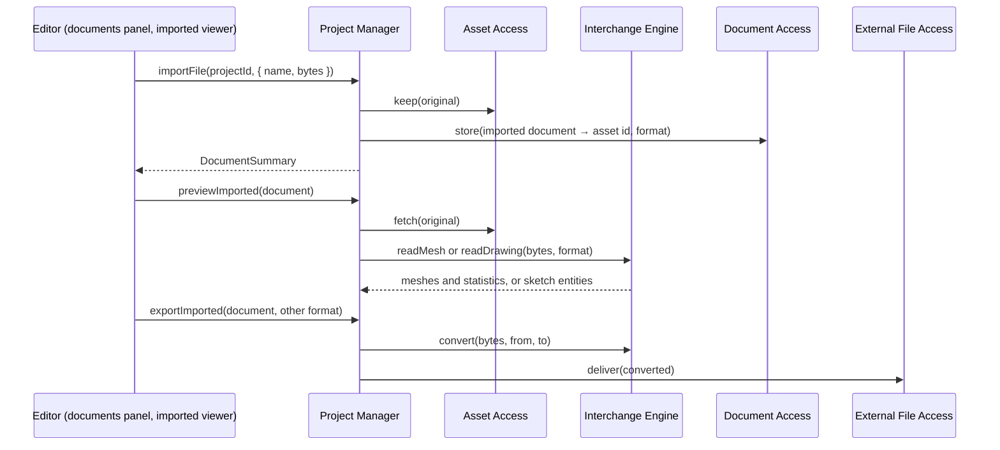
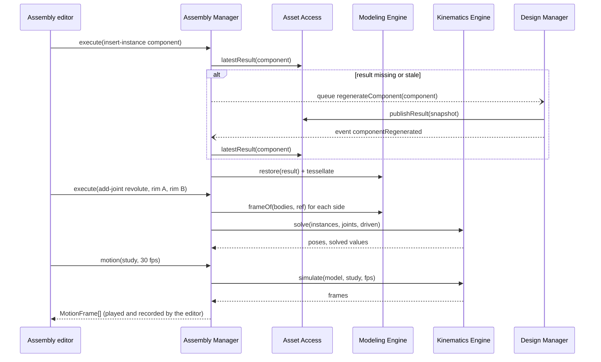

# Use cases and call chains

The architecture is validated by showing that every **core use case** is an interaction between the components of [[Architecture]] that follows the call rules. When a new requirement can be expressed this way, the design holds. When it cannot, the decomposition needs revisiting.

[TOC]

## Core use cases

| # | Use case | Components involved |
| --- | --- | --- |
| UC1 | Browse projects on start-up | Home → Project Manager → Project Access |
| UC2 | Create a component, sketch on a plane, extrude | Component editor → Design Manager → Parameter, Sketch, Modeling engines → Shape Access, Document Access |
| UC3 | Change a parameter and regenerate | Component editor → Design Manager → Parameter, Sketch, Modeling engines |
| UC4 | Export bodies as STL / STEP / OBJ / 3MF | Component editor → Design Manager → Interchange Engine → Shape Access; External File Access |
| UC5 | Export a sketch as DXF / SVG | Component editor → Design Manager → Interchange Engine; External File Access |
| UC6 | Import a STEP / STL / OBJ / DXF / SVG file | Home → Project Manager → External File Access, Asset Access, Interchange Engine, Document Access |
| UC7 | Build an assembly with a revolute joint and animate it | Assembly editor → Assembly Manager → Asset Access, Modeling, Kinematics engines; queued request to the Design Manager |
| UC8 | Validate a part for 3D printing or laser cutting | Component editor → Design Manager → Analysis Engine → Shape Access |

## UC1: Browse projects



## UC2: Sketch and extrude



## UC3: Change a parameter

The Design Manager owns the regeneration *sequence*. Engines skip items whose input hash has not changed.



## UC4: Export bodies



UC5 (sketch → DXF/SVG) uses the same chain. The engine receives the solved 2D geometry instead of body keys and does not need Shape Access.

## UC6: Import a file



The client picks the file (a picker or drag and drop needs a user gesture) and hands its name and bytes over. Components use the file through an **Insert body** feature (the Design Manager reads it with `readSolids`) and sketches through `insertDrawing`; assemblies insert it as an instance.

## UC7: Assembly with a revolute joint



The Assembly Manager consumes the component's **published result** and never repeats the Design Manager's regeneration workflow. When it needs a fresh result, it asks through a *queued* request, because manager-to-manager calls are never synchronous.

## UC8: Validate for 3D printing or laser cutting

```mermaid
sequenceDiagram
  actor U as User
  participant CE as Component editor
  participant DM as Design Manager
  participant AN as Analysis Engine
  participant SA as Shape Access
  U->>CE: open the check panel, choose a machine
  CE->>DM: execute(set-process)
  CE->>DM: validate()
  DM->>AN: validate({ named bodies, solved sketches }, document process)
  AN->>SA: get(body keys)
  AN-->>DM: Check[] (status, message, faces)
  DM-->>CE: ValidationReport
  CE-->>U: list of checks; faces of the focused check flagged in the viewport
```

The panel re-runs the validation after every change while it is open. Measuring follows the same chain: `measure(refs)` resolves the picked references in Shape Access and asks OCCT for areas, lengths, radii and the closest points.
