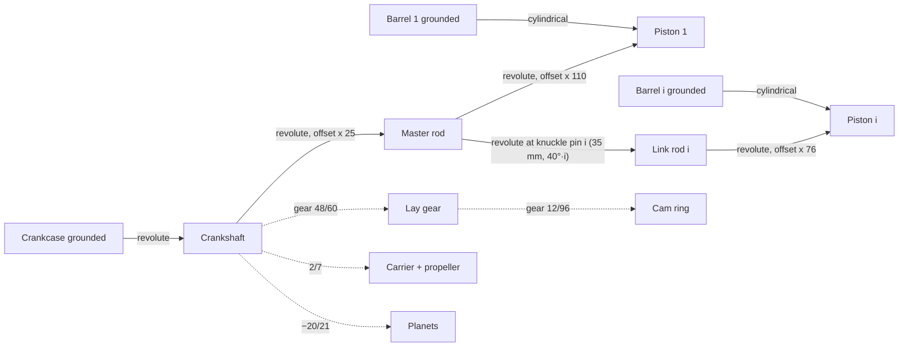

# Magnum opus

A nine-cylinder radial aircraft engine, modelled entirely by an AI agent through the MCP server ([[User guide/Automation#AI agents (MCP)]]) to find the limits of CADence: [[CAD-96]]. It lives in the project **Magnum Opus R-9 radial engine** in the desktop app's projects folder. The rule of the exercise: where CADence lacks a feature, the gap is filed as a task and the work stops there; no workarounds.

[TOC]

## Status

All parts are modelled, including the internal ring gear. The assembly **Radial engine** is built through `edit_assembly`: 79 instances and 42 pattern copies, 66 joints with nine closed slider-crank loops that solve, gear, carrier and planet links, nine roller tappets driven by cam links, nine pushrods riding on the tappets at their tilt ([[CAD-113]]), two motion studies, an animation and an exploded view *Taken apart* with radial steps ([[CAD-110]]).

**Round 4 (2026-10-17): the engine is complete.** Standing still nothing overlaps, the study runs four engine cycles without a collision, and there is an animation and the exploded view. The round-3 fixes ([[CAD-116]] to [[CAD-119]]) work on the engine. All nine tappet guides give one slider constant (67.0902 mm), in a new process and in the MCP server alike. The MCP server follows component and assembly changes made by another process. Three new findings, none blocking: [[CAD-120]] (one big jump of the crank flipped the nine loops into their mirror pose and saved it), [[CAD-121]] (the shape cache evicts its own placed parts in long scripts) and [[CAD-122]] (animations re-frame the camera every frame). **Round 5: drawings.** Phase 29 gives agents drawings and everything else the app does ([[CAD-124]]) and fixes the three round-4 findings. There are 27 part drawings (R9-01 to R9-27) and an assembly drawing (R9-00) with a parts list and balloons, all exported as PDF. Four findings: [[CAD-125]] (the spark plug's modelled thread takes minutes to draw in a new process), [[CAD-126]] (views have no configuration), [[CAD-127]] (dimensioning gaps) and [[CAD-128]] (`get_drawing` answers too long). **Round 6 (2026-10-18): the phase-30 fixes checked on the drawings.** The spark plug's drawing opens in a new process in 44.8 s the first time, with the process responsive throughout, and in 0.1 s after that; all 29 sheets export in 34 s. The crankcase's rear half has its own drawing (R9-01B). The master rod and link rod carry their centre distances, the piston a ⌀ on its side view and the wrist-pin position, the crankshaft its throw and R62, and the assembly drawing its overall size. Diameters take an angle, sections mark their cutting plane, and `get_drawing` answers with short refs. That last check corrected one of my notes: the wrist-pin axis is 17.9 mm from the crown, not 12. Two small follow-ups: [[CAD-129]] (one hidden circle still offered) and [[CAD-130]] (views drawn from triangles are loose segments: the assembly sheet's PDF is 12.2 MB). **Round 7 (2026-10-18): both checked.** The carrier's third ⌀12 pin circle is now hidden in its top view and no longer offered; the six ⌀8 holes still are. The assembly sheet's three views, drawn from the triangles, have 3,657, 2,662 and 3,146 paths (108,262, 57,292 and 65,766 before), and its PDF is 699 KB, smaller than the 6.3 MB of the exact views. Every part drawing's PDF shrank too, by a factor of two to three, and no annotation was lost. The new views stamp draws every drawing again once: the assembly sheet took 126 s, the spark plug 45 s.

> [!NOTE]
> Fixed in my own design in round 4: the cam link offsets come from the new slider constant (−8.8961 mm). The sun is turned half a tooth (7.5°) and the crank gear half a tooth (3.75°) on the crankshaft, and the lay pinion half a tooth (15°) in its component, which keeps the valve timing. The pushrod that touched its rocker box was only too high because of the old tappet heights. Fixed in round 3: a recess in the rear case for the crankcase's rear boss; intake ports as sockets for the 16 mm pipes; a cylindrical blade shank in larger hub sockets; a deeper piston crown for the master rod's eye; plugs tilted 45° outwards so neighbours clear; longer, narrower tappet guides; roller tappets (a flat foot offset from the cam's centre is hit side-on by the small lobes: the lift jumps 4 mm in a quarter of a degree); a pocket in each rocker box for the pushrod's travel.

> [!NOTE]
> With phase 26 the existing parts regenerate without errors, but some names changed: gear teeth have fewer faces ([[CAD-107]]), faces split into pieces keep their numbers ([[CAD-104]]), and patterned bodies are numbered without gaps (the master rod's knuckle pins are `kp`, then `kpat`, `kpat:2`, … `kpat:7`).

## Why a radial engine

It is mechanically rich and hard to simulate:

- **Master and link rods.** One master rod rides on the single crankpin; eight link rods hang on knuckle pins around its big end. With every piston sliding in its own cylinder, the mechanism has **nine closed slider-crank loops** sharing one master rod: a hard case for the assembly solver ([[User guide/Assemblies#Joints]]).
- **Two gear trains.** The cam ring turns at 1/10 of crank speed through a lay gear, and the propeller at 2/7 through a planetary reduction: motion links with exact ratios.
- **Repetition.** Nine of everything: instance patterns, circular feature patterns, and a part count (about 130 placed parts with the copies) that stresses regeneration, meshes and pictures.
- **Impressive both ways.** Animated, the pistons pump in a star; exploded, cylinders, heads and pistons fly out radially and the nose gear train comes apart along the axis.

## Main dimensions

Project parameters (used by the components):

| Parameter | Value | Meaning |
| --- | --- | --- |
| `bore`, `stroke`, `throw` | 50, 50, 25 mm | Cylinder bore, piston stroke, crank radius |
| `rod` | 110 mm | Master rod, crankpin to wrist pin |
| `knuckle` | 35 mm | Radius of the knuckle pin circle on the master rod |
| `link` | 76 mm | Link rod, knuckle pin to wrist pin |
| `crankpin`, `wristpin`, `knucklepin` | 36, 12, 10 mm | Pin diameters |
| `deck` | 105 mm | Distance of the cylinder seats from the crank axis |
| `head` | 160 mm | Distance of the barrel top from the crank axis |

> [!NOTE]
> The master rod's small end (110 mm) and the link rod's length (76 mm) are drawn with numbers, not with `rod` and `link`: the sketch shorthands did not take expressions for positions. Since [[CAD-108]] they do (`"x": "rod"`).

## Coordinates

Every component is drawn in **engine coordinates**, so that most joints can use component origins with offsets:

- The crank axis is the components' **Z axis**, the propeller towards +Z. The cylinders' mid-plane is z = 0.
- **Cylinder 1 points along +X**; cylinder *i* (1…9) at 40° × (*i* − 1) about Z.
- The **barrel, head, plug, pipes and pushrod** are drawn for one cylinder with the cylinder axis as their own Z (z = distance from the crank axis), and their +Y towards the propeller. A barrel is placed with the transform *T*·R*z*(40°(*i* − 1))·R*y*(90°).
- The **piston** has its axis along +X with the wrist pin at the origin and the pin along Z; the **master and link rods** have the big end at the origin and the shank along +X.
- In the assembly, the crankcase (grounded) is turned so that engine +Z points to world −Y (the front view looks at the propeller) and engine +X (cylinder 1) points up: columns of *T* are X → (0, 0, 1), Y → (−1, 0, 0), Z → (0, −1, 0).

Positions along the crank axis (engine z, mm), needed for joint offsets:

| Part | z | Notes |
| --- | --- | --- |
| Rear case | −118 … −40 | Intake bosses at z −78, r 106 |
| Crankcase rear half / front half | −65 … 0 / 0 … 65 | Configurations *Rear half* and *Front half* of one component |
| Crank webs, crankpin, rods, pistons | −25 … 25 | Cylinder mid-plane z = 0 |
| Cam ring (tracks, gear) | 66 … 88 | Drawn from z = 0: offset 66 |
| Lay gear (pinion, big gear) | 82 … 96 | Drawn from z = 0: offset 82; axis at r 54 |
| Crank gear | 90 … 96 | Drawn from z = 0: offset 90 |
| Planet carrier | 99 … 254 | Planets' plane at its z = 0: offset 104 |
| Sun, planets | 104 … 122 | Planets at r 42, every 120° |
| Nose case | 40 … 146 | Tappet guides at z 73, r 88 … 104 |
| Propeller hub, spinner | 254 … 324, 324 … 424 | Hub bolted to the carrier's flange (carrier z 150) |

## Parts

| Component | Made with | Count in the engine |
| --- | --- | --- |
| Crankcase | Nine-sided prism, revolved bearing bosses, cavity and bore cut by revolves, nine spigot holes (circular pattern), one half kept by an intersect; a configuration table picks the half | 2 (front, rear) |
| Crankshaft | Two webs with counterweights (one web mirrored), crankpin, both main journals in one revolve of two outlines | 1 |
| Master rod | Hub, two flanges (one mirrored), I-beam shank with pockets (mirrored), eight knuckle pins as new bodies by a circular pattern | 1 |
| Link rod | Two eyes and a shank, I-beam pockets, fillets | 8 |
| Piston, wrist pin | Revolve with three ring grooves, pin bosses, rod slot, pin bore, skirt trimmed by a cut | 9 + 9 |
| Cylinder barrel | One revolve of a 52-point outline: spigot, flange, eleven fins | 9 |
| Cylinder head | Finned revolve, rocker boxes and shafts, exhaust and intake ports (mirrored), two plug bosses tilted 45° (revolves about a sketch line, mirrored), a pocket for the pushrod | 9 |
| Spark plug | Revolve, hex, modelled M10 thread | 18 |
| Pushrod | Revolve with ball ends, 79 mm, from the tappet to the front rocker box | 9 |
| Exhaust stub, intake pipe | Sweeps of a tube along a line, arc and line | 9 + 9 |
| Cam ring | Disc with two tracks of five lobes (circular patterns) and a 96-tooth gear | 1 |
| Crank gear, lay gear | 48 teeth; 60 and 12 teeth on one hub (module 1) | 1 + 1 |
| Sun, planet gear | 24 and 18 teeth, module 2, 18 mm wide | 1 + 3 |
| Ring gear | 60 teeth, internal (ring gear part) | 1 |
| Tappet | Revolve: an 8 mm stem in the nose case's 8.4 mm guide, and a 10 mm roller (extrude) riding on the cam ring | 9 |
| Planet carrier | Plates and hollow propeller shaft in one revolve, three planet pins, six hub bolt holes | 1 |
| Nose case | Revolved shell, nine tappet guide bosses (circular pattern) | 1 |
| Propeller blade, hub, spinner | Loft through five twisted NACA sections (closed splines) from a 26 mm circle, with a cylindrical shank extruded in front; hub with three 26.4 mm sockets; spinner revolved from a spline | 3 + 1 + 1 |
| Rear case, magneto, display stand | Revolve with nine intake bosses (16.4 mm sockets) and a recess for the crankcase's rear boss; extrudes | 1 + 2 + 1 |

## Gear trains

**Cam drive.** A nine-cylinder four-stroke engine fires every cylinder once in two crank turns. A cam with *n* lobes per track serves it when it turns at 1/(2(*n* − 1)) of crank speed against the crank, or 1/(2(*n* + 1)) with it. With external gears only, the cam turns with the crank: five lobes at **1/10**. Crank gear 48 → lay gear 60, lay pinion 12 → cam gear 96 (module 1, centre distance 54 mm): 48/60 × 12/96 = 1/10, two meshes, same direction.

**Propeller reduction.** Sun 24 on the crankshaft, three planets 18 on the carrier, ring 60 fixed in the nose case (24 + 2 × 18). Carrier (propeller) = crank × 24/84 = **2/7** (3.5 : 1). Planet on the carrier = −(24/18) × (1 − 2/7) = **−20/21** of the crank angle.

## Assembly plan

With the assembly tools of [[CAD-97]]:

- **Grounded:** both crankcase halves, nine barrels (with their transforms), nose case, rear case, stand, ring gear.
- **Joints:** crankshaft revolute on the crankcase (origins); master rod revolute on the crankpin (origin offset 25 mm along X); piston 1 revolute at the master rod's small end (offset 110); link rod *i* revolute on knuckle pin *i* (offset 35 mm at 40° × *i*); piston *i* revolute at the link rod's small end (offset 76); every piston **cylindrical** in its barrel (barrel origin, piston crown face). Wrist pins rigid in their pistons; sun, crank gear rigid on the crankshaft; hub and spinner rigid on the carrier; lay gear revolute on the nose case at r 54; cam ring and carrier revolute on the crank axis; planets revolute on the carrier's pins. That is nine closed loops through the master rod.
- **Links:** lay gear from the crankshaft (−48/60), cam ring from the lay gear (−12/96), carrier from the crankshaft (2/7, a *Sun to planet carrier* link), each planet from the crankshaft (−20/21, *Sun to planet*). The tappets follow the cam ring by cam links ([[CAD-99]]): a profile of five lobes over the ring's turn.
- **Patterns:** heads, plugs and pipes: one instance each on cylinder 1, then a circular pattern of 9 about the crank axis. Blades: a circular pattern of 3 on the hub (copies of a turning instance turn with it, [[CAD-115]]).
- **Valve train:** each tappet slides in its guide (slider joint on the guide face) and follows the cam ring by a cam link. The pushrods are nine instances, not a pattern, since each follows its own tappet: rigid on the tappet's origin, moved 54 mm up its axis and tilted 20.5° about its x axis (`offset.tilt`, [[CAD-113]]), which is the tangential direction for every tappet.
- **Cam profiles:** computed, not drawn. The cam ring is a 56 mm base circle with five 7 mm lobes per track, and each tappet's roller (5 mm, its axis 28 mm off the cam's centre line) rides on the outline offset by the roller radius: lift(θ) = max(√(61² − 28²), cᵤ + √(12² − (28 − cᵥ)²)) over the lobes (cᵤ, cᵥ: the lobe centre in the tappet's frame), sampled where it bends (Douglas–Peucker to 0.02 mm, about 186 points per tappet). The lift is 7.8 mm, and its start is steep (about 10 mm per degree): small round lobes are hard on any follower.
- **Motion studies** *Running at 60 rpm*: a constant crank speed of 360°/s for 16 s (each turn: the propeller turns 2/7, the cam ring 1/10). *One cycle (720°)*: the same speed for 2 s, one cycle of all nine cylinders, for the animation.
- **Gear phases:** the sun is turned 7.5° and the crank gear 3.75° on the crankshaft (half a tooth each, in the rigid joints' `angle`), and the lay pinion 15° in its component (half a tooth; turning the cam ring instead would shift the valve timing by up to 19° of crank angle). The mesh positions are checked over four engine cycles.
- **Exploded view** *Taken apart*: 21 steps. Spinner, propeller, nose case (with the tappets), carrier and planets, ring, sun and gears forward along the axis; crankcase rear half, rear case and magnetos backward; stand down. Then radial steps ([[CAD-110]]) take every cylinder apart at once: blades, tappets, pushrods, heads with pipes and plugs, plugs further, barrels and pistons with their wrist pins move away from the crank axis.

## Drawings

Every component has a drawing *Drawing – <part>*, numbered R9-01 to R9-27 in the order of the parts table (crankcase, cases, cylinder, crank train, valve train, reduction gear, propeller, accessories, stand). The engine is R9-00 *Drawing – Radial engine*.

- **Sheets:** A4 or A3 landscape (the engine A2), at 5:1 down to 1:5, chosen so the views fit with room for dimensions. Title block: part name, number, material, drawn by Claude, revision A.
- **Views:** discs and gears show the axial view, a full section through the axis (*Section A-A*) and an iso view. Shafts, rods and pipes are in third-angle projection: front, top above it, right beside it, iso above the right view.
- **Dimensions:** overall lengths and heights, the diameters that matter (on side views too, between a cylinder's outlines), centre distances between circle centres, centre marks and centre lines. Gear data (teeth, module, pressure angle, pitch) and counts per engine go in a note.
- **Assembly drawing:** front, side and iso views at 1:5 with overall dimensions (810 high, 673 across the propeller, 674 long), a parts list of 28 rows (configurations and pattern copies counted) and 14 balloons on the side view.
- The crankcase has two drawings: R9-01 (front half) and R9-01B (rear half, views with `configuration: "rear"`, [[CAD-126]]).

## Findings

| Task | What | Kind | Fixed by |
| --- | --- | --- | --- |
| [[CAD-97]] | The MCP server cannot edit assemblies | missing, blocking | assembly tools ✅ |
| [[CAD-98]] | No internal (ring) gears | missing, blocking | ring gear parts, planetary links ✅ |
| [[CAD-99]] | No cam joints; motion links are linear | missing | cam links with a profile ✅ |
| [[CAD-100]] | Agents cannot see exploded views or motion | missing | pictures exploded, at a moment, animated; free camera, focus, hide, ghost ✅ |
| [[CAD-101]] | Round and bevel faces named after the first edge | bug | named after the nearest picked edge ✅ |
| [[CAD-102]] | `edit_component` answers with everything; a gear overflows the client | improvement, high | answers with the changes; filters ✅ |
| [[CAD-103]] | Pad on a revolved body: "not a valid solid" for some sizes | bug, high | booleans that fall back ✅ |
| [[CAD-104]] | Face names on shared surfaces; `~n` renumbering re-binds references | bug | kept names ✅ |
| [[CAD-105]] | Modelled thread ending at a shoulder cuts nothing, reports success | bug | groove stops short; refusals ✅ |
| [[CAD-106]] | Loft from a circle into splines twists | bug | sections lined up ✅ |
| [[CAD-107]] | Gear teeth are polygons: 23 faces per tooth | improvement | smooth flanks: 4 to 8 faces ✅ |
| [[CAD-108]] | MCP and sketcher papercuts | improvement | ✅ |

Round 2 (checking phase 26 and building the assembly):

| Task | What | Kind | Fixed by (phase 27) |
| --- | --- | --- | --- |
| [[CAD-104]] | Reopened: a revolve that joins names its trimmed faces after another curve | bug | a point inside the face, not off it ✅ |
| [[CAD-109]] | Pictures and animations of large assemblies crash ("Maximum call stack size exceeded") | bug, blocking | bounds in loops ✅ |
| [[CAD-110]] | Exploded views cannot move pattern copies | missing, blocking | copies in steps, radial steps ✅ |
| [[CAD-111]] | Assembly answers too long; `command_reference` too long and missing the parts contract; `near` by centres | improvement | brief answers, reference by topic, `near` by geometry ✅ |
| [[CAD-112]] | Joint frames on pattern copies point either way; touching parts count as interference; cam profiles dip | bug | copies' frames like the original's; touching tolerance; monotone cams ✅ |
| [[CAD-113]] | Joint offsets cannot tilt a frame | missing | `offset.tilt` ✅ |
| [[CAD-114]] | Collision check of the study: no answer within 30 minutes | improvement | changed pairs only, mesh screening, no leaks, progress ✅ |
| [[CAD-115]] | Pattern copies stand still in motion studies (and the collision check skips them) | bug | copies in every frame ✅ |

After phase 27 the flips on tappet joints 5–8 (and the cam links' ratio −1) pushed those tappets out to 146 mm from the axis: the copies' frames now follow the original's ([[CAD-112]]). Taken out in round 3.

Round 3 (checking phase 27, fixing my design, building the valve train):

| Task | What | Kind | Fixed by (phase 28) |
| --- | --- | --- | --- |
| [[CAD-116]] | The MCP server's open assembly keeps parts as they were before `edit_component` changed them | bug, blocking | new results followed, other processes caught up with, `not-ready` instead of old shapes ✅ |
| [[CAD-117]] | Joint frames on round faces come from the face's axis-aligned box: pattern copies and sessions disagree by up to 0.8 mm | bug | the middle of the face along its axis, from its parameters ✅ |
| [[CAD-118]] | `edit-feature` type change "does not exist"; `move-point` on a fixed point does nothing silently; revolve near its axis fails with "[object WebAssembly.Exception]"; offsets tilt in one plane only | improvement | kinds may change; the fix named; "crosses the axis (by … mm)"; `offset.lean` ✅ |
| [[CAD-119]] | An empty result file (a write cut short) makes the assembly impossible to open | bug | unreadable results rebuilt; files written whole; `cadence run` waits ✅ |

After phase 28 the joint frames on the nose case's guides (and on any round face that ends on a curved one) moved to the middle of the face. The tappets' slider constant became 67.0902 mm on all nine guides (before: 67.09 to 67.89 in a new process, 64.50 in the MCP server), and the cam link offsets were set again in round 4 ([[CAD-117]]).

Round 4 (checking phase 28, phasing the gears, collision check and animation):

| Task | What | Kind | Fixed by (phase 29) |
| --- | --- | --- | --- |
| [[CAD-120]] | `set-joint-values` crank 180° → 0° in one step leaves the master rod at −180° with the pistons slid through the crankcase (a valid mirror pose of cylindrical joints), and saves it; with slide limits the jump fails instead | bug | values reached in steps, as a study does ✅ |
| [[CAD-121]] | "Body crank has to be rebuilt first" when a large assembly publishes after a few moves; WebAssembly faults after 73 interference checks: the shape cache's `has()` is no use, so `place()` evicts its own parts | bug | open documents hold their shapes; placed copies never stored ✅ |
| [[CAD-122]] | Animations fit the camera per frame (the view jumps); the sheet shows one pose for whole-turn studies; GIFs land in the server's working directory | improvement | one camera; distinct moments; `CADence exports` ✅ |

Round 5 (technical drawings of every component): stopped at once, then done after phase 29.

| Task | What | Kind | Fixed by (phase 29) |
| --- | --- | --- | --- |
| [[CAD-123]] | Agents cannot make technical drawings: the app has them, but `create_document` takes only components and assemblies, and no tool or scripting call edits, reads, pictures or exports a drawing | missing, blocking | drawing tools, sheet pictures, PDF and DXF ✅ |
| [[CAD-124]] | And what else agents could not do: projects, versions, git, measuring, sketch checks, viewers, tables, build instructions, section pictures | missing | every manager operation as a tool ✅ |
| [[CAD-125]] | Drawing the spark plug (modelled thread) blocks a new process in hidden-line removal: 452.6 s for one view, the same views drew in seconds earlier | bug | the top view, along the thread's axis, takes 460 s exactly; views drawn within 20 s in a worker, else from the triangles, and kept with the drawing ✅ (phase 30) |
| [[CAD-126]] | Drawing views have no configuration: the crankcase's rear half cannot be drawn | missing | `configuration` on views ✅ (phase 30) |
| [[CAD-127]] | Dimensioning gaps: cylinder outlines are no anchors, no centre-to-centre dimensions, diameters always at 45°, hidden geometry offered, no section line, no anchors on assembly views | improvement | outlines, centres, leader angles, visibility, section lines, extremes, the component's material ✅ (phase 30) |
| [[CAD-128]] | `get_drawing` repeats the whole sheet, anchor names of up to 150 characters, one vertex under several names | improvement | anchors when asked for, once per place, short refs, model points ✅ (phase 30) |

Round 6 (checking phase 30 on the drawings):

| Task | What | Kind | Status |
| --- | --- | --- | --- |
| [[CAD-129]] | One ⌀12 pin circle under the carrier's top plate, nearly tangent to a ⌀8 bolt hole above it, is still offered as visible | bug | seen only where a stretch of it is drawn ✅ (phase 30) |
| [[CAD-130]] | Views drawn from triangles are loose two-point segments (231,000 on the assembly sheet, its PDF 6.3 → 12.2 MB) | improvement | lines between corners, chained outlines, joined paths ✅ (phase 30) |

Round 7 (checking the two fixes): both work on the engine's drawings (carrier top view, assembly sheet 699 KB, all 29 sheets exported in 79 s, no annotation lost). No new findings.

What worked well: revolves of long outlines, sweeps along line-arc-line paths, lofts through spline sections (from a round root since phase 26), circular patterns of cuts and of new bodies, mirrors, configurations (two crankcase halves from one component), the gear generator (spur and ring gears), modelled threads, fillets and chamfers, and `render_picture` for every part. In the assembly: nine closed loops solved from good starting values, links chained crank → lay gear → cam ring → nine cam followers, planetary links, patterns of turning instances, mass and bill of materials with configurations and copies. Since phase 27: pictures of the whole engine (79 instances, 42 copies) in seconds, the exploded view with radial steps across pattern copies, cam links with 186-point profiles, tilted joint offsets, and brief `edit_assembly` answers (a link change answers with the joints it moved, not the profiles).

## Tips for agents

- Sketch outlines with `add-polygon` and many points (fins, grooves) and revolve them: one feature instead of dozens.
- A part feature (gear, screw) or a hole may sit at the sketch origin: `points: ["origin"]`.
- After a face is split by a later feature its name gets `~1`, `~2`; refer to the exact piece, or pass a hint (the face's centre from `get_component`). Faces a later feature does not touch keep their numbers.
- Keep answers small: `edit_component` answers with what changed; ask `get_component` for `only: ["faces"]`, one `body`, a `match` pattern or `near` a point.
- Revolve about a sketch line that is an edge of the outline itself; an outline that crosses a separate construction line, even by a hair, is refused with how far it crosses ([[CAD-118]]).
- Points placed by `add-polygon` or `add-rectangle` with numbers are held by `fix` relations: to move them, replace the fix (delete it, add one at the new place); `move-point` refuses and names the fix ([[CAD-118]]).
- Move a driving joint of closed loops in small steps (or play a study); one big step can land the loops in their mirror pose, and the values are saved ([[CAD-120]]). Slide limits on cylindrical piston joints turn the mirror pose into an error instead.
- To phase two gears, scan a link offset across one tooth on a copy of the project (imported from a backup into an empty `--folder`) and check several mesh positions. Then set the middle of the clear range as a part angle (half a tooth is common), so other timing stays.
- A pushrod or strut along a direction no face has: a rigid joint on the moving part's origin with `offset.lean` (which way to tip) and `offset.tilt` (how far), from any frame ([[CAD-113]], [[CAD-118]]).
- Drawings: lay out views with room for dimensions (about 30 mm between views), then list anchors per view (`get_drawing` with `view`, `kind`, `diameter` or `extremes`) and attach annotations by `ref` ([[CAD-128]]). On revolved parts, dimension diameters between the two outlines of a cylinder (lines `s:…`) and lengths between their end points; centre distances between circle centres ([[CAD-127]]).
- Spread concentric diameters with `angle` on each (say 45°, 60°, 75°); without one, a leader goes where its text stays on the sheet.
- Anchors a view does not show are left out unless asked for (`hidden: true`) or the view draws hidden lines ([[CAD-127]]).
- An MCP server started before a build runs the old code. To check a fix, use a new process (`node dist/automation/cadence.mjs run <script>`) or restart the MCP server.
- A view that takes longer than 20 s to draw exactly (a modelled thread seen along its axis) is drawn from the triangles and says so in its `note`; drawn views are kept with the drawing ([[CAD-125]]).
